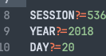
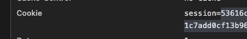

# Kotlin Advent of Code template

This template is what I built to solve advent of code using Kotlin. For now was only tested in `MacOs` but should work without much changes in any posix system.

### How to use it?

#### Clone this repo
```bash
git clone https://github.com/ponchoalv/kaoc.git
```

#### Change in the `Makefile` the `YEAR`, `DAY` and `SESSION`



The `SESSION` you can grave it from the aoc cookies once you are logged in:



#### Set the Makefile `all` to `new`

And then run `make`
```bash
make
```

The template will take care of downloading your input and store it in `src/year/day/input.txt` and create an empty `src/year/day/example_input/txt` too. Also it will create a `main.kt` that will have some minimal things, like reading the `input`.

Next, set the `Makefile` target `all` to `run` (for running against the `input.txt`) or `run/example` (for running against the `example_input.txt`) and have fun, this will take care of compiling and running the.

You can also call make using the targets directly with the `DAY`, `YEAR` or `SESSION` defined as environment variables.

```bash
$> YEAR=2018 DAY=19 make new

# OR run the run/example target
$> YEAR=2018 DAY=19 make run/example
```

### Usage of `git-crypt`

Due to the impossibility of sharing our inputs we should encrypt them, I choose to do this with `git-crypt` as a filter. It is configured with may public key in this repo. Just change it in your case or completely remove it if you're not going to commit your input files.

Have fun!